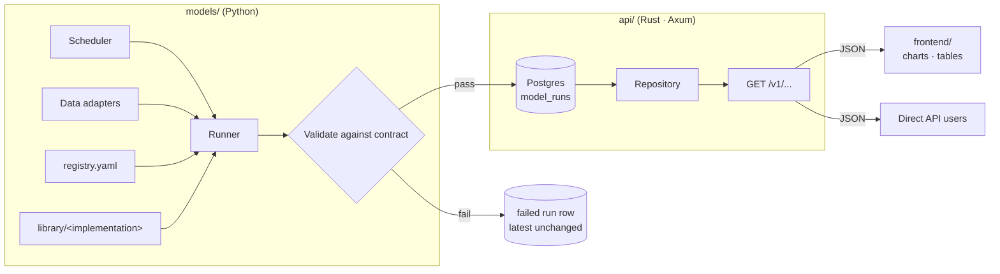

# Options Terminal — Requirements

**Status:** Draft v0.1 · **Owner:** Alejandro (Digital Assets) · **Date:** 2026-10-13
**Audience:** developers building the terminal. This set of documents defines *what* to build and the contracts between the pieces. It does not prescribe internal implementation beyond what is needed for the pieces to fit together.

| Doc | Covers |
|---|---|
| `README.md` (this file) | System overview, architecture, build plan, risks, open questions |
| `CONTRACTS.md` | The data contract shared by all three components: output envelope, payload kinds, slots, database schema |
| `MODELS.md` | `models/` — Python model framework, registry, runner, swap/promotion lifecycle |
| `API.md` | `api/` — Rust/Axum read-only JSON API |
| `FRONTEND.md` | `frontend/` — terminal UI, rendering, staleness, security |
| `BS_PRICER_IMPLEMENTATION_GUIDE.md` | First model: `bs_pricer` (Black-76 on Deribit for BTC/ETH/SOL/HYPE) across all four components |
| `PARITY_MONITOR_IMPLEMENTATION_GUIDE.md` | Second model: `parity_monitor` (put-call parity, implied carry, executable conversion/reversal edges, inventory lock rate) |
| `RV_FORECAST_IMPLEMENTATION_GUIDE.md` | Third model: `vrp_signal` (event-aware realized-vol forecast per tenor vs ATM implied, VRP z-score and decomposition; advisory only) |

Requirement keywords: **MUST** = required for acceptance, **SHOULD** = expected unless there's a documented reason not to, **MAY** = optional.

## Run it locally (Docker)

Needs Docker (Desktop or daemon) and `make`. From `options-terminal/`:

| Command | Does |
|---|---|
| `make start` | Creates `.env` on first run, builds the images, starts Postgres, API, runner and frontend, and waits until they are healthy. Open http://localhost:3000. |
| `make stop` | Stops everything and removes this project's containers, network, the images it built and their dangling layers. Keeps the database and snapshot volumes. Nothing outside this compose project is touched. |
| `make clean` | `stop`, then also deletes the database and snapshot volumes. |
| `make logs` / `make ps` / `make restart` | Follow logs / status / rebuild and restart. |
| `make probe` | Read-only Deribit and Hyperliquid calls that answer what `vrp_signal` can't check offline: candle row caps, 5-minute history depth, Hyperliquid's future `endTime`, DVOL daily candle hours. Prints a verdict table and writes `models/terminal_models/library/rv_har/validation/venue_probe.json`. Runs are correct whatever the answers; they inform the 5-minute upgrade and the docs. |

What runs:
- **`db`** (Postgres 17, local mode only), plus the one-shot **`db-init`**, which applies the migrations if needed and the setup in `docker/db/setup.sql`.
- **`api`**: `SET ROLE api_ro` on connect, so it's read-only.
- **`runner`**: `SET ROLE runner_rw` on connect. It syncs `models/registry.yaml`, then runs due models every minute.
- **`frontend`**: nginx serving the build and proxying `/v1` to the API, so the browser sees one origin. Strict CSP, and no query strings in the access log (A-34).

Only port 3000 is published (set `FRONTEND_PORT` in `.env` to change it).

### Using Supabase as the database

Add one line to `.env` and run `make start`:

```
SUPABASE_DB_URL=postgresql://postgres.<ref>:<password>@aws-0-<region>.pooler.supabase.com:5432/postgres
```

Copy it from Supabase → **Connect** → **Session pooler** → URI, and replace `[YOUR-PASSWORD]` with your database password. Special characters in the password must be URL-encoded; if the password contains `$`, wrap the whole value in single quotes. With `SUPABASE_DB_URL` set, no local Postgres container starts.

On every start, the one-shot `db-init` service (`docker/db/setup.sh`):
- applies `contracts/db/migrations` if the schema isn't there yet;
- runs `docker/db/setup.sql`, which is idempotent and:
  - removes the tables from Supabase's public REST API (the `anon`/`authenticated` roles), which would otherwise let anyone with the project's anon key read the model runs;
  - enables row-level security for our two roles.

**No extra logins.** The runner and API both connect with this one URL and switch roles on connect (`DB_ROLE`, i.e. `SET ROLE`):
- the runner to `runner_rw`, which can write runs;
- the API to `api_ro`, which is read-only.

A bug in the API therefore can't write. This is a guard against mistakes, not a hard boundary: whoever controls a container also holds the database password. A shared deployment should give each service its own login instead (CONTRACTS C-12).

Use the **Session** pooler (port 5432). The API holds a `LISTEN` connection and the runner takes advisory locks; the transaction pooler (6543) breaks both, and `make start` refuses it. The direct host is IPv6-only without Supabase's IPv4 add-on.

`make clean` deletes only local volumes; it never touches Supabase.

Notes:
- **The runner needs outbound access to `www.deribit.com`.** Without it, runs are recorded as failed (`source_unavailable`) and the UI shows "no output yet". Nothing is filled in.
- The pricer runs every 5 minutes, so the first runs land within about 5 minutes of `make start`.
- `parity_monitor` (shadow `parity_deribit`, Deribit fees `deribit-2026-10`) runs every minute. It appears as catalog entry 2, as a Parity tab on each asset page, and as parity columns in the cross-asset monitor.
- Migrations only run on a fresh volume. After a schema change, run `make clean` before `make start`.
- `make stop` leaves Docker's global build cache alone, because it can't be filtered by project. To reclaim that space too, run `docker builder prune`; that affects every project on the machine.
- Behind nginx the API's rate limiter sees one client address. That's fine locally; a shared deployment needs the trusted-proxy setup in API.md A-18.

---

## 1. What we're building

A read-only options analytics terminal. Python models compute options analytics (vol surfaces, smiles, term structure, skew metrics, etc.) on a schedule. A Rust API serves the latest outputs as JSON. A web frontend renders them as charts, tables and figures. End users can read data through the frontend or call the API directly with GET requests. There is no API key in v1.

## 2. Fidelity classification

**F3 (Big Uncertain) overall.** New system, three languages, and "done" isn't fully defined yet (first model set and deployment target are open — see §8).

It breaks into five **F2** pieces, which is how it should be built:

| # | Piece | Fidelity | Depends on |
|---|---|---|---|
| M0 | Contracts + DB schema + fixtures | F2 | — |
| M1 | Models framework + runner + one reference model | F2 | M0 |
| M2 | API | F2 | M0 |
| M3 | Frontend renderers + views | F2 | M0 |
| M4 | Integration, deploy, swap drill | F2 | M1–M3 |

M1, M2 and M3 run **in parallel** once M0 is merged. That is the main reason M0 exists as its own milestone.

## 3. Architecture

### 3.1 Core decision: the API never runs models

Models write validated outputs to a store; the API only reads from that store. The Rust server does not call Python, shell out, or compute anything.

Why:
- **Isolation.** A slow or crashing model can't take the API down. The API keeps serving the last good output (flagged stale) while the model is broken.
- **Latency.** GET requests are database/cache reads, not model runs.
- **Modularity.** Models can be added, swapped or retired without touching the API.
- **Auditability.** Every output is a stored, versioned run, so you can always answer "what did we show users at 14:00 yesterday, and which code produced it?"

**One narrow exception: evaluation endpoints.** Some slots need request-time computation against a stored run (e.g. pricing an arbitrary strike, or evaluating an OTC quote; see `BS_PRICER_IMPLEMENTATION_GUIDE.md`). The API MAY expose such an endpoint only if it is:
- a pure, deterministic function over a *stored* run;
- specified in Python (`models/terminal_models/core/quant/`), with the Rust port held to it by shared parity vectors in `contracts/fixtures/pricing/`;
- free of Python calls, market-data fetches and writes.

### 3.2 Data flow



### 3.3 Repository layout

```
options-terminal/
├── contracts/          # shared interface: JSON Schemas, slot definitions, DB migrations, fixtures
├── models/             # Python: framework, adapters, runner, model library
├── api/                # Rust: Axum read-only server
├── frontend/           # UI per front_end_design.md + building_secure_front_ends.md
├── front_end_design.md
└── building_secure_front_ends.md
```

> **Note on `contracts/`.** You specified three main folders. I recommend a small fourth, `contracts/`, because the output schema is the one thing all three components depend on. If it lives inside `models/`, the API and frontend end up depending on the Python package's directory layout, and contract changes get reviewed as "model changes." If you'd rather keep strictly three folders, put it at `models/contracts/` and keep every rule in `CONTRACTS.md` the same.

### 3.4 The modularity mechanism: slots vs implementations

This is the key concept for swapping models in and out of production.

- A **slot** is a stable, public product, e.g. `vol_surface`. Users, the API URL space and the frontend bind to slots.
- An **implementation** is a specific model that fills a slot, e.g. `vol_surface_svi` or `vol_surface_sabr`.
- `models/registry.yaml` maps each slot to exactly one production implementation and version, plus optional shadow implementations.

Swapping SVI for SABR is a one-line registry change in a reviewed PR. No API change, no frontend change, and no client breakage, because both implementations must produce the slot's contracted payload. The full lifecycle is in `MODELS.md` §5.

## 4. Build plan

| Milestone | Deliverable | Exit criteria |
|---|---|---|
| **M0** Contracts | `contracts/`: envelope + payload JSON Schemas, slot definition format, Postgres migrations, ≥1 golden fixture per payload kind (plus invalid fixtures) | Schemas validate all valid fixtures and reject all invalid ones in CI; migrations apply cleanly to an empty DB |
| **M1** Models | `models/` core, adapters interface, runner CLI, registry, one reference implementation end-to-end | `runner run <slot>` writes a validated run to a local Postgres; a failing model writes a failed run row and leaves latest unchanged |
| **M2** API | `api/` with all endpoints in `API.md` | Integration tests pass against a fixture-seeded DB; OpenAPI served; latency targets met |
| **M3** Frontend | Catalog, slot view, one renderer per payload kind, staleness and error states | Every golden fixture renders against a mock API; design and security checklists signed off |
| **M4** Integration | Deployed stack, scheduler, monitoring, swap drill | E2E test green; **swap drill**: promote a shadow implementation to production and roll it back with zero API or frontend changes |

Parallel lanes, per quant-dev:

| Lane | Work |
|---|---|
| Planning | Finalize slot list and first model set (open questions §8); slot contracts |
| Building | M1, M2, M3 in parallel off M0 fixtures; the API team and frontend team use the same fixtures, so neither waits on real models |
| Reviewing | Contract tests on both sides of every boundary; security review of API + frontend before M4 |

## 5. Cross-cutting requirements

- **X-1** All timestamps MUST be UTC, ISO 8601 with `Z` suffix. No local times anywhere in storage or JSON.
- **X-2** Every numeric series MUST declare its unit in the payload (`CONTRACTS.md` §4). Implied vol is transmitted as a decimal (0.55), never as percent (55). Display formatting is the frontend's job.
- **X-3** Missing or invalid values MUST be `null`, never `NaN`, `Infinity` or a sentinel like `0` or `-999`. `NaN` is not valid JSON and zero is a plausible value.
- **X-4** Every response that carries model output MUST carry `as_of`, the run's implementation and version, and a staleness flag.
- **X-5** All components MUST emit structured JSON logs with a correlation ID. The runner logs `run_id`; the API logs `request_id` and the `run_id` it served.
- **X-6** No secrets in code or in the repo. DB credentials and data-source keys come from environment variables or the secrets manager.
- **X-7** All three components MUST pin dependencies with a committed lockfile (`uv.lock`, `Cargo.lock`, the frontend lockfile).
- **X-8** CI MUST run each component's tests plus the cross-component contract tests on every PR.

## 6. Success criteria (system level)

1. A user can open the terminal, pick a slot and underlying, and see the latest output with its `as_of`, implementation/version and freshness.
2. The same data is available via `GET /v1/slots/{slot}/latest` as JSON matching the published schema.
3. Adding a new implementation to an existing slot requires changes only in `models/`.
4. Adding a new slot with an existing payload kind requires changes in `models/` and `contracts/` only. The frontend renders it with a generic renderer automatically.
5. A broken model never produces a blank or wrong screen: users see the last good output with a stale badge.
6. Any number shown on screen can be traced to a `run_id`, a code SHA and an input hash.

## 7. Risk flags

| Risk | Severity | Mitigation |
|---|---|---|
| No API key: outputs are public to anyone with the URL | Accepted | Research tool (§8 Q1). The API keeps an auth middleware seam so adding keys later is a config change (`API.md` §7). |
| Python/Rust contract drift | High | Single schema source in `contracts/`; contract tests on both sides in CI (`CONTRACTS.md` §7). |
| Stale data presented as fresh | High | Staleness computed by the API from manifest `max_age`, shown on every view. |
| Bad model output (NaN, arbitrageable surface, unit error) reaching users | High | Validation gate in the runner: schema, bounds, and slot-specific sanity checks before write (`MODELS.md` §6). |
| Silent regression on model swap | Medium | Mandatory shadow period and a diff report before promotion (`MODELS.md` §5). |
| Unit and convention ambiguity (vol points vs decimal, vega per 1 vol point vs per 1.00, strike vs moneyness) | Medium | Units and conventions are mandatory fields in the payload; conventions are documented per slot. |
| Two-venue timestamp skew: underlying from Hyperliquid, options from Deribit | Medium | Snapshots must be within `max_input_skew_seconds` or the run fails (`MODELS.md` M-9b). |
| Source unavailable | Medium | Run fails and the API serves the last good output flagged stale. Never a placeholder price (`MODELS.md` M-9a). |

## 8. Questions

Decided:

- **Q1 End users:** research use. No API key in v1; no-auth exposure is accepted.
- **Q2 Market data:** Hyperliquid public feed for underlying prices; Deribit public API for option chains, IV and greeks, since Hyperliquid lists no options. Both keyless. See `MODELS.md` §3.2.
- **Q7 Frontend:** `front_end_design.md` takes precedence over all frontend design choices (React, hand-drawn SVG charts, no chart library). See `FRONTEND.md` §2.

Open (need answers before M4; M0–M3 can proceed):

3. **First production slots.** Candidate list in `CONTRACTS.md` §5; confirm which ship in v1.
4. **Refresh cadence** per slot (every minute? every 15 minutes? end of day?).
5. **Deployment target** (cloud provider, container platform, scheduler).
6. **History retention** — how long run history must be queryable.

## 9. Assessment of this plan (quant-dev)

| Lens | Result | Note |
|---|---|---|
| Functional | PASS | Covers all three components and the requested GET-only, no-key API. |
| Security | PASS | No-auth exposure accepted for research use (§7). Read-only DB role, rate limiting, CORS allowlist, CSP and an auth seam are all specified. |
| Performance | PASS | API serves cached reads; targets in `API.md` §6. |
| Complexity | CLEAN | One extra folder (`contracts/`) and one extra concept (slots). Both are what make swapping cheap; nothing else is speculative. |
| Edge cases | COVERED | Nulls, stale data, failed runs, unknown payload kinds, missing scopes and empty history are each specified. |
| Compliance | PASS | Read-only research analytics; no trading and no derivatives exposure. Revisit if distribution goes external. |

**Verdict: SHIP to developers for M0**, with §8 questions 3–6 answered before M4.

## 10. Compound notes

- **Rule:** Never let a serving layer run models inline. Write validated outputs, then serve reads. Reuse this pattern for any future WSC dashboard API.
- **Rule:** Bind consumers to *slots*, not implementations. This is the general pattern for swapping anything (pricers, hedge-ratio engines, scoring models).
- **Rule:** Units are part of the data, not the docs. Any numeric field that crosses a language boundary carries its unit.
- **Reusable:** the envelope + payload-kind contract and the golden-fixture test pattern apply directly to other desk dashboards.
- **Lesson from the reference Axum snippet:** it targets older Axum syntax (`/:id`). Pin the Axum version in docs and examples; see `API.md` §9.

